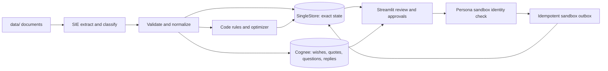

# Last Wishes

*The agent follows up. The family decides.*

Last Wishes helps a family compare funeral quotes against a parent's recorded wishes. It extracts quoted lines, points out prices needing clarification and services the family did not select, remembers the follow-up across an app restart, and sends only the family's approved arrangement **request**. The final state is **“Arrangement request sent — awaiting provider confirmation.”** It never pays or books.

This is a hackathon prototype. Linda, Maya, and providers A/B/C are fictional. The public General Price List is a separate extraction test and is never mixed into the fictional comparison.

## Run locally

Python **3.12** is required. The checked-in lock file was made with the working `.venv`; use its binaries rather than the system Python. On a fresh machine:

```bash
python3.12 -m venv .venv
.venv/bin/pip install -r requirements.lock.txt
cp .env.example .env
```

Fill `.env` with the service credentials you have. `SINGLESTORE_URL` uses the SingleStore connection string. `SIE_API_KEY` is required for live quote extraction; `SIE_BASE_URL` defaults to `https://api.superlinked.com`. `LLM_API_KEY` enables Cognee's `add`/`cognify` semantic path; `ANTHROPIC_API_KEY` enables optional drafted wording. `PERSONA_API_KEY` and `PERSONA_TEMPLATE_ID` must be sandbox credentials for the identity gate. Never commit `.env` or paste keys into issues, logs, or screenshots.

```bash
.venv/bin/python -m pytest -q
.venv/bin/streamlit run app.py
```

Open <http://localhost:8501>. The app stores quote versions, approvals, send status, audit records, and SIE traces in SingleStore. Without `SINGLESTORE_URL`, it uses the local SQLite development database. The SingleStore free shared tier permits at most ten tables; the schema uses exactly ten, without rowstore tables. FTC references are stored as `documents` rows. `db.py` does not create vector columns in this tier.

## Demo flow

1. In **Wishes**, load Linda's note and Maya's confirmation.
2. In **Quotes**, read fictional A, B, and C. In **Compare**, A's crematory charge stays unresolved; C's casket statement appears beside public FTC guidance as a **review flag / needs clarification**. The “Not needed” list shows excluded optional items and their quoted savings. The optimizer chooses among plans with known prices and does not call an incomplete quote cheapest.
3. In **Approvals**, review the exact clarification recipient, quote version, and message. Approval #1 inserts one sandbox outbox row; retrying the same approval does not send another.
4. Stop and restart Streamlit. In **Inbox**, read `data/reply_A_v2.txt`. It creates A-v2, keeps A-v1, and replans. **Memory** shows the Cognee recall query plus returned nodes and edges; **Diff** shows the changed fee, resolved unknown, source excerpts, and plan change. `data/reply_A_alt.txt` is a differently worded input for the same extraction path.
5. Select a quote and review the arrangement card and evidence receipt. A Persona sandbox inquiry must report `approved` before Approval #2 can send the exact arrangement request. The outbox is sandbox only; it does not contact a real provider.

No number shown in the comparison is a scripted result. Each comes from the input documents through extraction, validation, and code-side planning. Unknown prices remain unresolved; a starting-at price has no invented ceiling. The LLM may draft or explain, but it does not decide flags, totals, compliance, or approvals. If an LLM key is absent, wording is marked as a template draft.

## Architecture and data ownership



`contracts.py` defines the shared `LineItem`, `Flag`, `Plan`, recall, and SIE trace shapes. SingleStore is authoritative for exact prices, quote versions, approval hashes, and send-once state. Cognee stores graph relationships and provenance for recall; it cannot authorize a send. Approval is tied to one message and quote version, and a later quote invalidates the prepared card.

## Superlinked SIE

The wrappers use the documented `sie-sdk` API. Each call records recipe, model, latency, input length, and source excerpts in `sie_calls`; the app exposes these in the **Trace** drawer.

| Recipe | Model | Use |
|---|---|---|
| `extract` | `fastino/gliner2-large-v1` | Entity spans from quote/reply segments |
| `classify` | `fastino/GLiNER2.5-Decide` | Choice among core fee, optional, cash advance, package, stated requirement |
| `rerank` | `Qwen/Qwen3-Reranker-4B` | Source excerpt ranking when requested |

Money and price types are parsed from verbatim excerpts in code. Explicit optional-service normalization corrects observed Decide false `basic_fee` labels for viewing and embalming. The casket review flag still requires SIE's `stated_requirement` label and the code rule, with the provider text beside the FTC reference. Live checks on 2026-11-20 extracted A, B, C, both replies, and 60 candidate lines from the public PDF. The PDF also produced price-less guidance sentences as candidates; that is a known extraction limitation, so its output is kept separate from the fictional comparison.

## Cognee memory

`memory/cognee_mem.py` writes typed `Person`, `FamilyMember`, `Wish`, `Document`, `Provider`, `Quote`, `LineItem`, `Question`, `Reply`, and `Plan` data points and their links through Cognee's graph APIs. Its public calls are `remember_wish`, `remember_confirmation`, `remember_quote`, `remember_question`, `remember_reply`, `remember_plan`, `recall`, `graph_snapshot`, and `reset_memory`. `recall` calls `cognee.search` with `GRAPH_COMPLETION` and `only_context=True`, and returns the actual nodes and edges. With `LLM_API_KEY`, raw text is also queued through `cognee.add` and `cognee.cognify`; that LLM path requires separate live verification.

The graph uses local FastEmbed embeddings and the Turso graph provider. A real Streamlit stop/start on 2026-11-20 preserved the wishes and quotes, and recall after the reply returned the pending question and linked wishes as actual graph nodes and edges. The **Memory** tab has a counterfactual control to exclude a wish from recall.

## Benchmark and Firedrill

The [live benchmark](bench/results.md) hand-labels 13 source-verified lines from the fictional quotes and the separate public price list. It runs the app's SIE extract/classify pipeline and a general Qwen3.8 27B chat model on the same excerpts. SIE got **36/39 price fields** and **13/13 categories**; Qwen chat got **39/39 price fields** and **11/13 categories**. SIE missed the certificate estimate range on one isolated line; Qwen mislabeled A's unresolved crematory fee and B's alternative container. The report includes all cases, wall times, cost estimates and their limits; raw predictions and usage are in [`bench/results.json`](bench/results.json).

Firedrill's six scenarios were run by Manank against his own copy of the pipeline and data, not against this repository's app. The platform run covered two of the six: **2 of 2 met the threshold of 75**, with scores of **98.25** (a differently worded reply still yields the crematory charge) and **94.5** (casket flag wording avoids "illegal" and "violation"). See [`tests/firedrill/PLATFORM_SCORES.md`](tests/firedrill/PLATFORM_SCORES.md) (campaign `8a1c6958-7bd5-43fc-89b5-d6d5f8b36ce8`). The other four scenarios ran only as local tests, so they are not platform results. The platform's own state still read "running" when last checked, though both drills showed completed. Limits: the agent under test used the local deterministic parser, and the approval and outbox drills used a stand-in, so they say nothing about this repository's `approvals.py` and `outbox.py`. Those safety paths are covered by this repository's own offline tests (`tests/test_approvals.py`, `tests/test_outbox.py`).

## Sources and limits

- Fictional notes, quotes, and replies: [`data/SOURCES.md`](data/SOURCES.md).
- Real price list: [Menlo Park Funeral Home and Cremation Services General Price List](https://cdn.f1connect.net/cdn/15678M-Xj0/gpl/Menlo%20Park%20Funeral%20and%20Cremation%20Services%20GPL.pdf), effective March 8, 2026; captured November 20, 2026. Used for extraction only.
- Public reference: [FTC Funeral Rule guidance](https://consumer.ftc.gov/articles/ftc-funeral-rule), checked November 20, 2026. Flags ask for clarification and do not give legal verdicts.

Persona verifies who is approving, not legal authority. The app uses fictional recipients and a sandbox outbox. No real provider receives an email. The team is **Lisha** (app, SingleStore, approvals, Persona, integration) and **Manank** (SIE pipeline, seed data, rules, optimizer, Cognee, benchmark/Firedrill).
